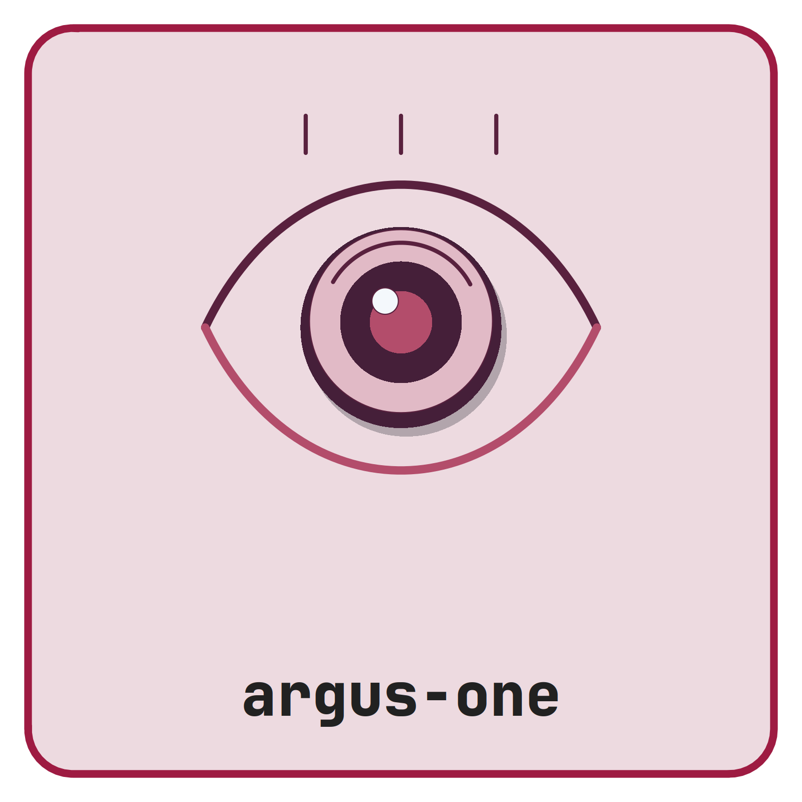

<picture class="cttir-readme-logo"><source class="cttir-logo-dark-source" media="(prefers-color-scheme: dark)" srcset="assets/branding/logo-with-name-dark.png" /></picture>

# Argus One

[](https://doi.org/10.5281/zenodo.21889976)

A Zotero plugin that merges duplicate items by **DOI only**, keeping the newest record's field values and preserving every collection the duplicates appeared in.

Zotero's built-in duplicate detector is fuzzy by design — it inspects titles, creators, and years. That is the right default for most libraries but a poor fit for curated collections where the DOI is the source of truth. Argus One does one job: it groups items that share a normalized DOI, picks a survivor by `dateAdded`, fills missing fields from older copies, unions tags / related items / collection memberships, re-parents attachments and notes, and trashes the older records inside a single Zotero transaction.

## Compatibility

- Manifest target: **Zotero 9.x**. Zotero 10 is not yet qualified for this plugin.
- The current development build requires validation in a disposable Zotero 9 profile before release.
- Cross-platform (Windows, macOS, Linux)

## Installation

1. Build the development XPI using the commands below. No GitHub Release was available at the 30 October 2026 audit; the root-level archives are historical and differ from the current source.
2. In Zotero, open **Tools → Plugins**.
3. Click the gear icon → **Install Plugin From File…**
4. Select the downloaded `.xpi`.
5. Restart Zotero if prompted.

## Usage

1. Open **Tools → Argus One: merge DOI duplicates…**
2. A confirmation dialog reports how many DOI duplicate groups were found and how many items will be moved to trash.
3. Confirm to merge. All work runs inside one Zotero database transaction, so any error rolls the entire operation back.
4. Empty the Zotero trash yourself when you have verified the result.

### Merge rules

For every group of items that share the same normalized DOI:

1. **Pick the newest** by `dateAdded` (ties broken by higher `itemID`).
2. **Newest wins on conflicts.** If the survivor already has a value in a field, that value is kept. Empty fields are filled from older siblings.
3. **Collections are unioned.** If the DOI appeared in collections `A` and `B`, the survivor ends up in both.
4. **Tags, collections, and relations** are merged by Zotero, including incoming links and citation redirects. Creators are borrowed only if the survivor has none.
5. **Attachments** remain separate records, including trashed attachments; files are not coalesced. Zotero moves child notes and updates their item links. It retains the earliest `dateAdded` after selecting the newest survivor.
6. **Older copies move to trash** — never deleted permanently.

### DOI normalization

Case-insensitive. Strips `https://doi.org/`, `https://dx.doi.org/`, and `doi:` prefixes. Items without a dedicated DOI field also have their `Extra` field scanned for `DOI: …`.

### Out of scope

- Items without a DOI are ignored.
- Group libraries are not touched (user library only in this version).
- No fuzzy title matching — use Zotero's built-in **Duplicate Items** view for that.

## Building and checking from source

Prerequisites: Node.js 24 (for development tests), Python 3.9 or newer, and
Zotero 9.x for the separate integration check. No npm packages are required.

```sh
node --test tests/argus.test.cjs
python3 -m unittest discover -s tests -p 'test_*.py'
python3 tools/build.py
```

Install `dist/argus-one-0.1.0-dev.xpi` only in a disposable profile containing
synthetic records until the [integration checklist](docs/maintenance-2026-10-30.md)
is complete. The build embeds the current source and MIT licence, checks every
archive entry, and leaves the historical root archives intact. Repeated builds
from identical source produce identical bytes.

Updates are manual until a published update feed exists. The previous manifest
referenced a missing `updates.json`; that URL has been removed.

## Documentation

Full vignette and walkthrough: <https://cttir.github.io/argus-one/>

## How to cite this plugin

If Argus One supports your research, please cite it.

**BibTeX**

```bibtex
@software{heller_argus_one_2026,
  author  = {Heller, Raban},
  title   = {{Argus One: DOI-based duplicate merger for Zotero}},
  year    = {2026},
  version = {0.1.0},
  url     = {https://github.com/CTTIR/argus-one},
  license = {MIT}
}
```

**APA**

> Heller, R. (2026). *Argus One: DOI-based duplicate merger for Zotero* (Version 0.1.0) [Computer software]. https://github.com/CTTIR/argus-one

> `CITATION.cff` retains the historical version and identifier. The development changes above are unreleased; DOI registration is not established by the badge.

## Links

- **Documentation:** <https://cttir.github.io/argus-one/>
- **Issues:** <https://github.com/CTTIR/argus-one/issues>
- **License:** [MIT](LICENSE)
- **Changelog:** [CHANGELOG.md](CHANGELOG.md)
- **Contributing:** [CONTRIBUTING.md](CONTRIBUTING.md)

## Citation

If you use this software, please cite it as:

> Heller, R. (2026). *Argus One: DOI-based duplicate merger for Zotero* (Version 0.1.0) [Computer software]. Zenodo. https://doi.org/10.5281/zenodo.21889976

DOI: [10.5281/zenodo.21889976](https://doi.org/10.5281/zenodo.21889976)

## Use of LLM tools

Where applicable, LLM tools were used for narrowly defined, non-authorial tasks:
copyediting, prose refinement, Markdown/LaTeX formatting, boilerplate scaffolding
(such as CI configurations and build scripts), and code refactoring. Tools included
[Chat AI](https://kisski.gwdg.de/leistungen/2-02-llm-service/), the KISSKI
(GWDG) service, and self-hosted **Mistral Small (24B, Apache-2.0)** served through
a local **vLLM architecture** on an Ubuntu Linux workstation with Intel
processors and NVIDIA GPUs. The self-hosted model ran locally, with no data sent
to third parties.

All scientific claims, methodological choices, analyses, interpretations and
conclusions remain the authors' own. Where applicable, LLM-generated material
must be reviewed and revised before inclusion, and references must be verified
against their DOI, arXiv ID or ISBN.

Local software setup: vLLM with Python/PyTorch, plus R and RStudio.

## Branding

The supplied CTTIR Coder Edition v5 artwork and its editable R source are in
[`tools/branding`](tools/branding/README.md). Use that renderer to reproduce
the primary badge, alternate editions, and platform icons.
