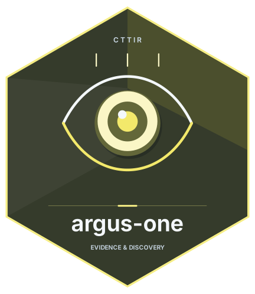

{height=139px fig-alt="argus-one hex logo"}

## Current local candidate

Version **0.1.1** uses Zotero's native merge operation after choosing the newest
record's values and filling valid empty fields. The manifest declares Zotero
9.0–10.0.*; installed 10.0.5 API inspection and adapter regression tests support
this candidate, while live-profile validation is recorded in
[the audit](AUDIT-2026-10-30.md).

Build from the repository root:

```bash
node --test tests/*.test.cjs
python3 tools/build.py
python3 tools/build.py --check
```

Install `dist/argus-one-0.1.1.xpi` in a disposable Zotero profile first. The root
0.1.0 archives are preserved historical files, not the current build. No 0.1.1
release or automatic update feed has been published.

## Review and merge

Open **Tools → Argus One: merge DOI duplicates…**. The preview lists each DOI,
newest survivor key/title, and older record keys. Same-type, non-trashed personal
library items are eligible; incompatible groups, unsaved edits and changed
previews are refused. An item with an invalid DOI or conflicting Extra identifiers
is not guessed.

Native Zotero merging preserves collection/tag behavior, child and annotation
remapping, incoming relations and replacement identity for citations. It can
consolidate attachments by native PDF text or web-title matching, including
files that are not byte-identical, and uses the earliest `dateAdded` for the
merged record. Newest field selection is made before that native timestamp rule.

Each group is a separate transaction. If a later group fails, completed groups
remain merged and the result dialog reports them. Keep a full data-directory
backup, inspect results before emptying trash, and rerun Workbench extraction
and audit after record or attachment identities change. Native merge is not
nested inside another database transaction.

DOI normalization removes known URL/`doi:` prefixes, folds case, and requires
`10.` plus 4–9 digits, `/`, and a non-whitespace suffix. Suffix punctuation is
preserved. No fuzzy matching, group-library changes or permanent deletion is
performed. A shared DOI is a grouping key, not proof against misassigned metadata.

The citation below identifies the published 0.1.0 release; this local candidate
has not been given a new release DOI.

## Citing Argus One

If you use Argus One in published work, please cite it. The canonical
metadata lives in
[`CITATION.cff`](https://github.com/CTTIR/argus-one/blob/main/CITATION.cff).

**BibTeX**

```bibtex
@software{heller_argus_one_2026,
  author  = {Heller, Raban},
  title   = {Argus One: DOI-based duplicate merger for Zotero},
  year    = {2026},
  version = {0.1.0},
  license = {MIT},
  url     = {https://github.com/CTTIR/argus-one},
  note    = {Published 0.1.0 release}
}
```

**APA**

> Heller, R. (2026). *Argus One: DOI-based duplicate merger for Zotero*
> (Version 0.1.0) [Computer software].
> https://github.com/CTTIR/argus-one

## Links

- **Source code:** <https://github.com/CTTIR/argus-one>
- **Issues:** <https://github.com/CTTIR/argus-one/issues>
- **Releases:** <https://github.com/CTTIR/argus-one/releases>
- **License:** [MIT](https://github.com/CTTIR/argus-one/blob/main/LICENSE)
